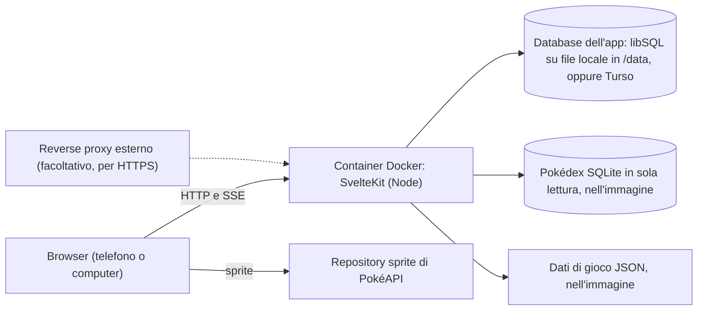

# Nuzlocke SoulLink Companion – Specifica dei requisiti

Oct 3, 2026 · @Lorenzo

## Panoramica

Una web app self-hosted in un unico container Docker che accompagna le run Nuzlocke Soul Link di Pokémon, per qualsiasi generazione. I dati utente stanno di default in un database libSQL locale nello stesso container, con l'opzione di passare a Turso online cambiando una variabile d'ambiente.

Obiettivi:

- Gestire più run, ognuna con N giocatori soul-linked (non solo 2).
- Tracciare incontri, team, box, morti, medaglie e level cap.
- Aiutare nelle lotte con informazioni complete, senza suggerire la mossa da usare.
- Offrire un Pokédex completo di tutte le generazioni.
- Restare leggera e veloce, anche su telefono.

## Progetti simili

Nessun tracker esistente unisce Soul Link con più di 2 giocatori, tracking dettagliato, helper per le lotte e Pokédex completo: è questo lo spazio del progetto.

| Progetto | Punti forti | Limiti rispetto ai nostri obiettivi |
| --- | --- | --- |
| [Soullocke](https://github.com/jynnie/soullocke) | Pensato per il Soul Link, link condiviso, sync in tempo reale, timeline | Solo 2 allenatori, niente livelli e mosse per scelta |
| [Nuzlocke Tracker](https://github.com/diballesteros/nuzlocke) | Tabelle di incontro per area, level cap, calcolatore danni, export/import | Pokémon fino alla Gen 8 |
| [nuzlocke.app](https://github.com/domtronn/nuzlocke.app) | Dati di route e boss, supporto ROM hack tramite patch | Squadre dei boss precaricate, non adatte ai randomizer |

## Account, ruoli e amministrazione

L'app usa account veri con login; l'amministratore viene creato al primo avvio del container.

- Login con email e password; utenti e sessioni salvati nel database dell'app.
- Admin creato dalle variabili d'ambiente `ADMIN_EMAIL` e `ADMIN_PASSWORD`, con cambio password obbligatorio al primo accesso.
- L'admin gestisce utenti, modalità di registrazione (aperta, solo su invito, chiusa) e dati personalizzati come le route aggiunte a mano.
- Ruoli per run: proprietario (regole e inviti), giocatore, spettatore in sola lettura. Se un account viene eliminato, le sue run restano con il nome anonimizzato e la proprietà passa al giocatore successivo; una run cancellata si può recuperare per 30 giorni.

## Run, giocatori e regole

Ogni run ha un solo gioco, uguale per tutti gli N giocatori, e un set di regole scelto alla creazione che vale per tutti e si applica in automatico; solo gli override per specie sono del singolo giocatore.

Regole base (sempre attive):

- Un solo incontro per area; se fallisce, l'area è persa.
- Pokémon esausto = morto, senza revive.
- Run persa quando un giocatore resta senza Pokémon vivi o va in wipe.
- Soprannome obbligatorio.

Regole Soul Link (sempre attive):

- Gli incontri della stessa area sono collegati tra tutti i giocatori; lo starter conta come un normale incontro collegato.
- Collegati = stesso destino: tutti in team o tutti in box insieme.
- Se uno muore, muoiono tutti i partner.
- Se un giocatore perde l'incontro di un'area, l'area è saltata per tutti.

Regole opzionali (attivabili per run):

- Dupes clause: se un giocatore incontra una specie della stessa linea evolutiva di un Pokémon che possiede già (anche morto), solo lui ha un altro tentativo nell'area; gli incontri degli altri giocatori restano validi e il collegamento avviene con il suo nuovo incontro.
- Restrizione del tipo primario: niente tipi primari ripetuti nel team.
- Regali, incontri fissi e scambi in gioco come incontri separati: con la regola attiva non consumano l'incontro dell'area, senza contano come incontro dell'area in cui avvengono. Le grotte nascoste di Nero 2 e Bianco 2 si trattano come gli incontri fissi, con la specie scelta dal Pokédex ([ADR 0003](../adr/0003-giochi-aree-e-impostazioni-della-run.md)).
- Flag randomizer (vedi sezione dedicata).
- Calcolatore danni attivo o no.
- Stanze interne come aree separate, **accesa di base**: accesa, ogni stanza interna di una grotta (per esempio la Guidance Chamber di Mistralton Cave) è un'area con il suo incontro; spenta, un incontro in una stanza conta nell'area della grotta principale. Non si può cambiare dopo il primo incontro registrato.

Impostazione della run, non una regola: la **difficoltà** di Nero 2 e Bianco 2 (facile, normale, sfida), uguale per tutti i giocatori, con normale di default; il level cap segue la scelta.

Il **gioco** di una run è una versione (Nero, Bianco, Nero 2, Bianco 2), non la coppia. L'**ordine delle aree** è solo di visualizzazione: ogni area si registra quando si vuole.

Run già iniziate:

Una run si può creare anche a gioco già avviato, così il companion si può adottare in qualsiasi momento.

- Alla creazione si indica il punto raggiunto: medaglie ottenute e level cap attuale.
- Le aree già visitate si registrano con il loro esito (catturato, fallito, saltato) oppure si segnano come "precedenti, non tracciate".
- Si inseriscono team, box e Pokémon morti attuali, con i collegamenti Soul Link tra i giocatori.
- I dati mancanti si completano anche dopo; da quel punto il tracker funziona normalmente.

## Tracker della run

Il tracker segue la run area per area, nell'ordine di progressione del gioco, con lo stato di ogni giocatore affiancato.

- Stato dell'incontro per giocatore: catturato, fallito, fuggito, saltato per dupe, regalo.
- Dati del singolo esemplare: soprannome, livello, natura, abilità effettiva, le 4 mosse attuali, posizione (team, box, morto).
- Tappe del gioco (medaglie, Superquattro, boss della storia) superate da ogni giocatore, e level cap calcolato per giocatore dalla prima tappa non ancora superata; l'override manuale del level cap è uno solo per tutta la run. Nei giochi senza palestre le tappe sono prove o lotte obbligate, senza medaglia.
- Cimitero con causa della morte: avversario, mossa, area.
- Timeline degli eventi della run.
- Sincronizzazione in tempo reale tra i giocatori collegati. Chi apre un dato in modifica lo blocca per gli altri; se due giocatori salvano lo stesso dato, vince l'ultimo salvataggio.

## Concorrenza e lock

I lock sono consultivi e a scadenza: dicono chi sta modificando un dato senza bloccare nessuno, e se due giocatori salvano lo stesso dato vince l'ultimo, senza perdere niente.

- **Granularità**: un singolo dato (l'incontro di un giocatore in un'area, un esemplare, le medaglie di un giocatore, le impostazioni della run), mai l'intera run.
- **Presa**: all'apertura di un modulo di modifica. Se il dato è già in modifica, l'interfaccia mostra "in modifica da" e il nome, e chiede conferma prima di modificare comunque.
- **Durata**: lease di 60 secondi, rinnovato ogni 20 secondi finché il modulo è aperto. Se il browser si chiude o perde la rete, il lock scade da solo.
- **Rilascio**: al salvataggio, all'annullamento, alla chiusura della pagina o alla scadenza.
- **Dove vivono**: nella memoria del server, che è una sola istanza. Un riavvio li azzera, e va bene perché sono consultivi. Presa e rilascio arrivano agli altri via SSE.
- **Versioni**: ogni dato ha un numero di versione e il salvataggio invia quello letto. Se nel frattempo è cambiato, il salvataggio passa comunque, ma chi è stato sovrascritto riceve un avviso con i valori nuovi. Il valore precedente resta nel diario della run.
- **Azioni di gruppo** (morte o spostamento di Pokémon collegati): una sola transazione. Se uno dei dati coinvolti è in modifica da altri, l'interfaccia lo mostra e chiede conferma.
- **Sblocco forzato**: non serve, perché ogni lock scade da solo.

## Rete instabile

Chi gioca è spesso su telefono: le regole con rete assente sono nell'[ADR 0002](../adr/0002-rete-instabile.md).

- **Senza rete non si modifica**: nessuna coda. Quando la connessione risulta persa, i pulsanti di salvataggio sono disattivati e ciò che si stava scrivendo resta compilato.
- **Connessione persa**: il server manda un segnale ogni 15 secondi; dopo 40 secondi senza eventi compare un avviso discreto. Il client si riconnette da solo con attese crescenti (al massimo 30 secondi) e, al ritorno, recupera gli eventi mancanti dal diario della run, oppure ricarica tutto lo stato se sono troppi o il server si è riavviato.
- **Lock**: scadono da soli; al ritorno il client prova a riprenderli. Chi salva dopo aver perso il lock sovrascrive comunque, e chi è sovrascritto riceve l'avviso.
- **Idempotenza**: ogni scrittura porta una chiave generata dal client, valida 24 ore; un secondo invio restituisce la prima risposta.
- **Aggiornamenti**: le modifiche semplici si vedono subito ("in invio"); le azioni Soul Link attendono sempre la risposta del server.
- **Bozze**: ciò che si sta scrivendo si conserva nel browser, per modulo, fino al salvataggio o per 24 ore.
- **Offline completo**: fuori ambito fino alla 1.0.

## Randomizer e override dei dati

I dati di base vengono dal Pokédex; l'utente può sovrascriverli per specie, per giocatore, solo dentro la run.

Flag randomizer:

- Le aree restano, ma senza tabelle di incontro: la specie si sceglie liberamente dal Pokédex.
- Nessuna squadra avversaria viene mai suggerita.
- Senza flag, le tabelle di incontro restano come suggerimento.

Override:

- Chiave: run + giocatore + specie. Il Pidgey modificato da un giocatore non tocca quello del compagno.
- Campi modificabili: tipi, statistiche base, abilità possibili, mosse imparabili (scelte dall'elenco completo).
- Valgono per tutti gli esemplari di quella specie nel gioco di quel giocatore, suoi e avversari.
- I dati sovrascritti sono segnalati e si può tornare al valore originale.
- Il Pokédex globale e le altre run restano intatti.
- Pulsante "copia override a un altro giocatore" per chi usa lo stesso seed.
- Tracker, helper e calcolatore usano sempre i dati effettivi: override se presente, altrimenti Pokédex.

## Helper per le lotte

L'helper mostra tutte le informazioni utili per decidere, ma non suggerisce mai la mossa: niente ordinamento per "mossa migliore" e niente evidenziazioni.

- Scegli il tuo Pokémon in campo e l'avversario dal Pokédex completo, senza squadre precaricate.
- Le mosse dell'avversario si aggiungono man mano che le vedi usare.
- Vedi tipi, debolezze e resistenze di entrambi.
- Per ogni tua mossa: efficacia (×0, ×¼, ×½, ×1, ×2, ×4), STAB, categoria fisica o speciale, potenza.
- Per le mosse osservate dell'avversario: efficacia sul tuo team.
- Le squadre incontrate si possono salvare nel log della run, per chi deve ancora affrontarle.
- Usa sempre i dati effettivi del giocatore che combatte, anche per l'avversario.

Regole per generazione:

- Tabella dei tipi della generazione della run: in Gen 1 mancano Buio e Acciaio, dalla Gen 6 c'è il Folletto.
- Fino alla Gen 3 fisico o speciale dipende dal tipo, non dalla mossa.
- Abilità che cambiano l'efficacia (Levitazione, Grassospesso, Magidifesa) e Teracristallizzazione in Gen 9.

Calcolatore danni:

- Sempre incluso nell'app, attivabile per run.
- Basato su @smogon/calc, con le meccaniche di tutte le generazioni.
- Riceve gli override del giocatore come dati personalizzati di specie.

## Pokédex

Il Pokédex copre tutte le generazioni ed è incluso nell'immagine, quindi le ricerche non toccano né il database utente né internet.

- Fonte: snapshot di [PokeAPI/api-data](https://github.com/PokeAPI/api-data), elaborato in fase di build.
- Contenuti: specie, tipi, statistiche, abilità, mosse, evoluzioni, incontri per area.
- Sprite caricati dal repository sprite di PokéAPI, in cache nel browser.

## Lingue

La lingua è sempre selezionabile, con inglese e italiano completi come priorità.

- Interfaccia tradotta con Paraglide.
- Nomi di Pokémon, mosse e abilità dai nomi localizzati di PokéAPI, con l'inglese come riserva.
- Nomi di aree e medaglie in inglese nell'MVP: PokéAPI non ha nomi italiani delle località di Unima ([ADR 0004](../adr/0004-fonti-dei-dati-nomi-e-giochi-per-rilascio.md)).

## Architettura e stack

Il browser parla solo con il container; il container legge il Pokédex in locale e salva i dati delle run in libSQL, su file locale o su Turso.

Il database dell'app è libSQL (file locale o Turso); non c'è nessun servizio di database esterno obbligatorio. I dati di PokéAPI entrano solo in fase di build, per generare il Pokédex.

| Componente | Scelta | Motivo |
| --- | --- | --- |
| Framework | SvelteKit con adapter Node | Poco JavaScript nel browser, frontend e backend in un solo progetto |
| Database | libSQL con Drizzle ORM: file locale su volume Docker (default) o Turso online | Nessuna rete tra app e database, stesso codice in locale e online, piano gratuito Turso da 5 GB |
| Autenticazione | Better Auth | Gira nel container, nessun servizio esterno |
| Lingue | Paraglide | Traduzioni compilate, si carica solo la lingua in uso |
| Calcolo danni | @smogon/calc | Meccaniche di tutte le generazioni, dati di specie personalizzabili |
| Pokédex | SQLite in sola lettura nell'immagine | Ricerche veloci, nessuna dipendenza esterna |
| Tempo reale | Server-Sent Events | Nessun servizio extra, tutte le scritture passano dal container |
| Immagine | Build multi-stage su Node Alpine | Circa 150-200 MB (stima) |

## Vincoli e punti aperti

- In modalità locale i dati vanno su un volume Docker (per esempio /data/app.db): senza volume, ricreando il container si perde tutto. I backup sono a carico di chi installa, con una copia periodica del file o con Litestream.
- SQLite locale e sync in tempo reale via SSE presuppongono una sola istanza del container; con più istanze serve un canale di notifica condiviso.
- I dati di incontro di PokéAPI per le generazioni recenti potrebbero essere incompleti: da verificare, con route aggiungibili a mano dall'admin.
- PokéAPI non ha le squadre degli allenatori: per scelta non vengono usate.

* L'app gira su qualsiasi server e parla solo HTTP. Chi vuole HTTPS mette un reverse proxy davanti, senza modifiche all'app. In HTTP password e sessioni viaggiano in chiaro, e l'app lo segnala all'admin.
* I primi giochi supportati sono Bianco, Nero, Bianco 2 e Nero 2, nell'MVP. Nel rilascio 0.5 arrivano i 17 giochi per cui nuzlocke.data ha aree e boss; nel 1.0 Let's Go, Leggende: Arceus e Leggende: Z-A ([ADR 0004](../adr/0004-fonti-dei-dati-nomi-e-giochi-per-rilascio.md)).
* Il comportamento con rete instabile è definito in [Rete instabile](#rete-instabile).

- [ ] Modello dati (prossimo passo).
